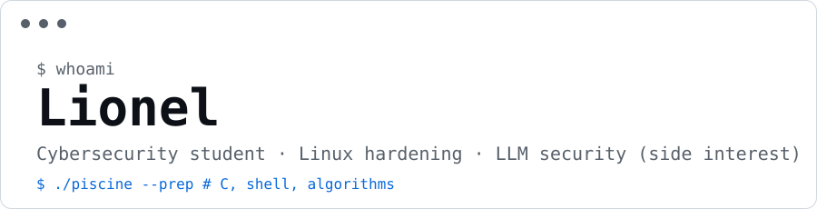

[Email](camddvi@email)

## Currently

- Preparing the **42 Piscine**: C, shell, algorithms

## Background

- **Access control and integrity**: academic PAM and FIM architecture with Tailscale, Apache Guacamole, Ansible, Auditd, Promtail/Loki/Grafana, sudo RBAC
- **Hardening**: Linux, Docker, Fail2Ban, MFA, Active Directory
- **AI security (theory)**: RAG, agents, OWASP LLM Top 10, prompt injection, guardrails. No production work yet.

## Stack

`Bash` `C` `Python` `Linux (Kali)` `Docker` `Ansible`
